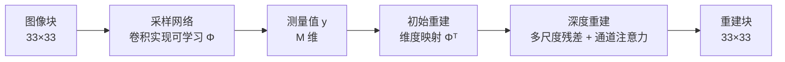
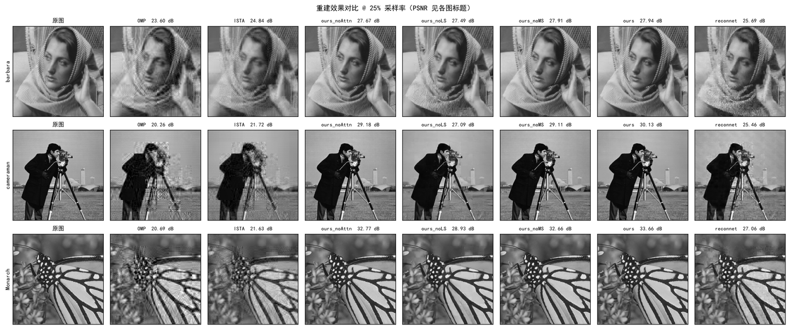
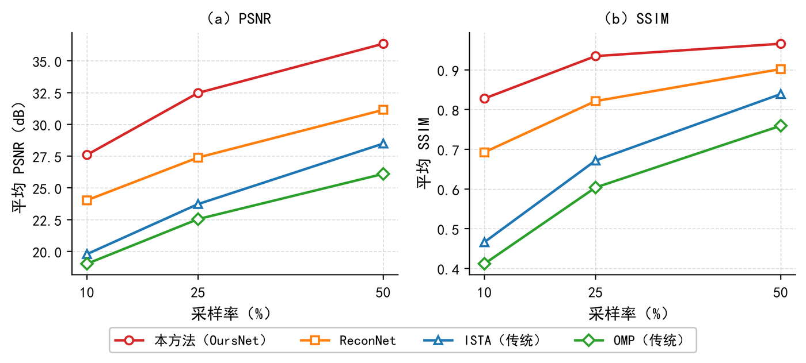
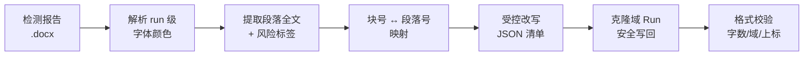

<div align="center">

# 周靖凌 · AI 应用工程

**把有硬约束的真问题推到收尾，而不是做一堆通识 Demo。**

南昌职业大学 · 软件工程技术 · 2027 届<br>
方向：深度学习 / 图像重建 / 文档自动化 / AI 工作流

</div>

---

## 我是谁

软件工程专业在读，目前在做两件看起来无关、实际是同一件事的活：

1. **从零复现并超过一个深度学习方法**——图像压缩感知重建，自己搭采样矩阵、自己写 OMP/ISTA 基线、自己设计网络，最终在 Set11 上以 25% 采样率拿到 **32.47 dB / 0.9346 SSIM**，比复现的深度学习基线 ReconNet 高 **5.08 dB**。
2. **给一个格式约束极严的文档批处理任务写工具**——3.5 万字的 Word 文稿需要逐段修订，而任何一次"整段替换文本"都会破坏交叉引用域和上标格式。我写了一套定位 → 改写 → 写回 → 校验的流水线，把这件事从手工变成可重复执行。

两件事的共同点是：**AI 能生成 80%，但剩下的 20% 必须靠验证。** 我不接受"看起来对"的输出——PSNR 要能复算，改完的文档要能通过格式检查，改动的段落要能逐条回溯。

---

## 两个案例

| # | 案例 | 一句话 | 关键数字 |
|---|---|---|---|
| 01 | [图像压缩感知重建](./case-01-compressive-sensing/) | 自己实现采样→重建全链路，自研三级级联网络超过 ReconNet | 32.47 dB @25%，快 9× |
| 02 | [文档批量改写的格式保真](./case-02-docx-aigc-pipeline/) | 在 OOXML 层面安全替换整段文本，不破坏域与上标 | 47 段 / 0 格式损坏 |

---

## 案例 01：别信报告，自己跑一遍

**问题**：压缩感知的理论承诺是"用远少于奈奎斯特的测量重建图像"。文献里的 PSNR 数字互相不可比——有的在 231×231 裁剪区结算，有的不做 padding，同一方法能差 0.3 dB。

**做法**：先把口径钉死，再谈性能。

| 项 | 我的约定 |
|---|---|
| 块尺寸 | 33×33 不重叠，N = 1089 |
| 采样率 | M / 1089，取 10% / 25% / 50% |
| 测试口径 | Set11 resize 256×256 → padding 264 → 采样重建 → 裁回 256×256 |
| PSNR | `10·log10(MAX²/MSE)`，MAX = 1.0（[0,1] 域） |

网络结构（三级级联，端到端联合训练）：



**结果**（Set11，256×256，无噪声，平均 PSNR / SSIM）：

| 方法 | 10% | 25% | 50% |
|---|---|---|---|
| OMP | 19.02 / 0.4117 | 22.54 / 0.6038 | 26.10 / 0.7593 |
| ISTA | 19.79 / 0.4662 | 23.72 / 0.6716 | 28.49 / 0.8391 |
| ReconNet | 24.03 / 0.6925 | 27.39 / 0.8213 | 31.14 / 0.9019 |
| **本文方法** | **27.60 / 0.8278** | **32.47 / 0.9346** | **36.34 / 0.9657** |



> 25% 采样率下的逐图对比。三行分别是 barbara / cameraman / Monarch，标题中的 PSNR 为该图单图数值。



**消融**（25%，同一训练配方，只改一个开关）：

| 移除的模块 | PSNR | Δ | 结论 |
|---|---|---|---|
| 完整模型 | 32.47 | — | 基准 |
| 可学习采样 | 29.31 | **−3.16** | 贡献最大，固定随机矩阵是主要瓶颈 |
| 多尺度残差 | 31.75 | −0.72 | 中等 |
| 通道注意力 | 31.67 | −0.80 | 中等 |

**我踩过的坑**：`ours_noMS` 和 `ours_noAttn` 的训练日志里各有一个发散点（loss 突增到 16 和 519）。画收敛曲线时如果不剔除，对数轴会被压平，看起来像"模型没在学"。这两个 checkpoint 保留在仓库里，不删——它们是真实训练过程的证据，不是需要藏起来的瑕疵。

**[→ 完整技术细节与复现命令](./case-01-compressive-sensing/)**

---

## 案例 02：AI 改得动文字，改不动格式

**背景**：一份 3.5 万字的技术文稿需要逐段修订。检测报告给出的是一份带颜色标注的 Word——红色段落是高风险、橙色是中风险、灰色是未检出。

**第一个坑**：报告是 Word，不是 JSON。问题清单只存在于 `w:color` 属性里。



**第二个坑，也是真正的技术难点**：正文里的引用角标 `[1]`、`[14]` 不是普通文本，是 Word 的 REF 交叉引用域，XML 结构是：

```
fldChar begin → instrText " REF _Ref123 \r \h " → fldChar separate → 结果文本 → fldChar end
```

整段换文本时，如果用 `paragraph.text = "新文本"` 这种朴素写法，域会被压平成死文字，上标（如 10⁻³ 的「−3」）也会变成普通字符。这个损坏在肉眼上几乎看不出来，只有在更新域或打印时才会暴露。

正确做法是**整组克隆域 Run**，并且只改 `w:r`、保留 `pPr`：

```python
# 完整实现见 case-02/src/docx_safe_replace.py
def replace_paragraph(para, new_text):
    """保留域结构与段落属性，只替换可见文本"""
    runs = para.findall(qn("w:r"))
    # 1) 记录第一组域 Run 作为模板
    # 2) 只把新文本写进「域结果」段，其余 run 清空
    # 3) pPr 完全不动
```

**结果**：47 个高风险段落全部改写完成，格式校验 0 损坏，所有引用角标仍可正常更新。

**最重要的一条判断**：第一轮我让 AI 把文字改得更"书面化"——结果改完检测分反而上升。原因很反直觉：**越工整、越像范文，越像 AI 写的**。真正的改法是打散三项并列、减少"从而/具有/综上所述"、让句长参差。这个结论推翻了我第一轮的整个方向，也让我重新理解了"AI 味"到底是什么。

**[→ 完整复盘与工具代码](./case-02-docx-aigc-pipeline/)**

---

## 我怎么用 AI

我的用法不是"问一句拿一个答案"，而是**让 AI 产出候选，我自己写工具做验收**。

| 环节 | 做法 |
|---|---|
| 长文阅读 / 中文写作 | 交给长上下文模型，一次投喂整章，避免片段化理解 |
| 代码攻坚 / 架构决策 | 用推理型模型，要求给出多种方案和失败路径，而不是直接给代码 |
| 批量重复劳动 | 写成脚本驱动，AI 只负责"生成候选文本"，定位/写回/校验全部由代码保证 |
| 结果验收 | 一律跑一遍：PSNR 复算、格式检查、冒烟测试。**AI 说通过不算通过** |

**我的模型分工不是玄学**：长文和文献类任务用长上下文模型，一次性投喂全文比多轮追问更准；代码和设计决策用推理型模型，但要求它先列失败路径再写实现；批量任务不给模型，给脚本。

---

## 技术栈

`Python` `PyTorch` `NumPy / SciPy` `scikit-image` `OpenCV` `Streamlit` `Plotly` `python-docx / lxml (OOXML)` `Git` `VS Code`

---

## 这个仓库怎么用

```
portfolio/
├── assets/                      截图与结果图
├── case-01-compressive-sensing/ 图像压缩感知重建（含代码仓库链接）
└── case-02-docx-aigc-pipeline/  OOXML 批量改写工具与复盘
```

两个案例的代码独立成库，本仓库只放**结论、图表和复盘**——判断过程比代码本身更值得看。

---

## 联系

- 邮箱：`YOUR_EMAIL@example.com`
- 求职方向：AI 应用 / 算法工程 / 文档智能，实习或校招均可，接受线下面试

<div align="center">

**南昌职业大学 · 软件工程技术 · 2027 届**

</div>
