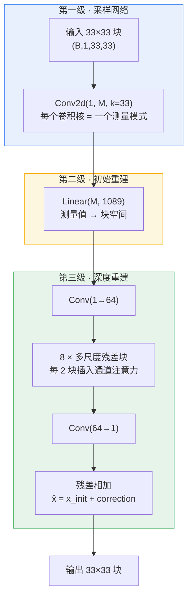
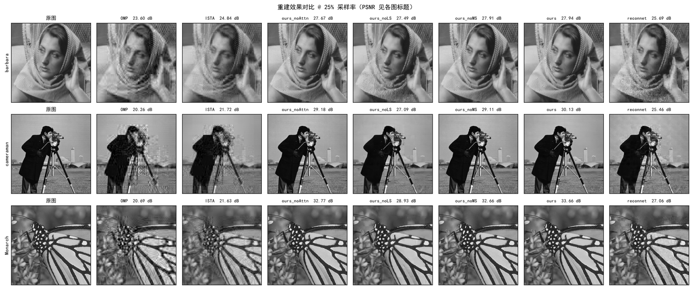
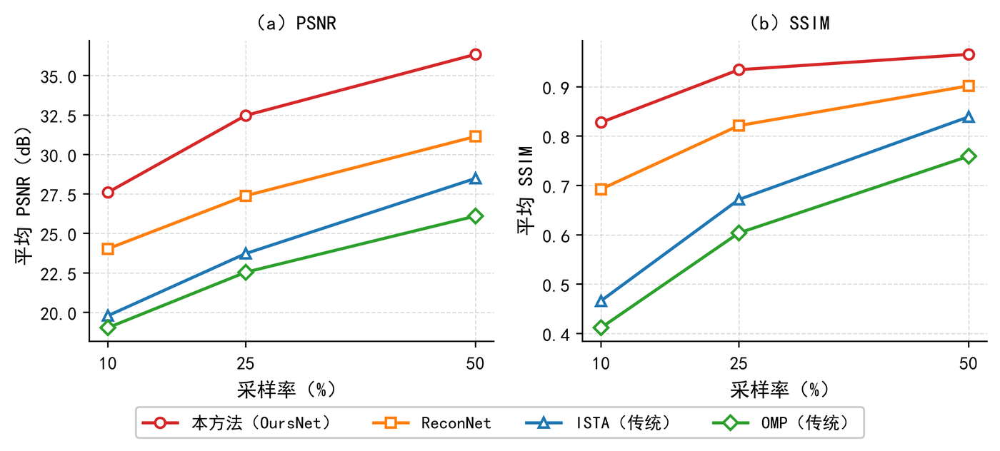
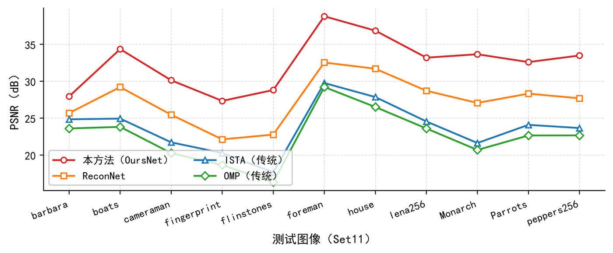

# 案例 01 · 图像压缩感知重建：从基线复现到超越

> 代码仓库：[`cs-reconstruction`](https://github.com/YOUR_GITHUB_ID/cs-reconstruction)（毕设主工程，含训练/评估/演示系统全链路）
>
> 关键结果：Set11 @ 25% 采样率 **32.47 dB / 0.9346 SSIM**；比复现的深度基线 ReconNet 高 5.08 dB；单图重建 0.05 s。

---

## 1. 为什么这件事不简单

压缩感知的承诺是"用远少于奈奎斯特的测量重建图像"。理论上很美，工程上有三个坑：

**坑一：测量矩阵的假设在真实图像上不成立。** 经典 CS 依赖 RIP 条件和变换域稀疏假设，但自然图像的纹理区系数衰减很慢，直接套用会在边缘产生块效应和模糊。这不是调参能解决的，是模型假设的问题。

**坑二：迭代求解的速度不可接受。** OMP 要估稀疏度、ISTA 要迭代上千次，单张 256×256 图像的重建在分钟级。我实测的 ISTA（1000 次迭代 + FISTA 加速）单图约 0.46 s，看起来还能忍，但那是 256×256 灰度图——真实场景的分辨率下会线性甚至超线性膨胀。

**坑三：文献里的 PSNR 数字互相不可比。** 这一条最要命，第 4 节详述。

我的判断是：**坑一和坑二应该一起解决**。既然迭代慢是因为"固定变换域 + 反复求解"，那就把整个求解过程换成前馈网络；既然固定随机矩阵对重建任务是盲的，那就让采样端也参与训练。

---

## 2. 设计：三级级联



**每一级解决什么问题：**

| 级 | 做什么 | 为什么这么做 |
|---|---|---|
| 采样 | `Conv2d(1, M, kernel_size=33)` | 33×33 卷积核恰好覆盖整个块，等价于一个 M×1089 的测量矩阵，但保留了卷积的权重共享与梯度流。**权重初始化为高斯随机**（与经典 CS 的 Φ 同分布），所以起点和传统方法一致，训练只是让它偏离得更聪明 |
| 初始重建 | `Linear(M, 1089)` | 对应经典的 Φᵀ 转置重建，给深度网络一个有意义的初值，而不是从噪声开始学 |
| 深度重建 | 多尺度残差 + 通道注意力 | 学的是**修正量**而不是原图。块效应需要小感受野修细节，结构错误需要大感受野修全局——三个扩张率（1/2/3）的并行分支正好覆盖这两种需求，且不增加参数量 |

**参数量**（实测，`build_model` 直接统计）：

| 模型 | 10% | 25% | 50% |
|---|---|---|---|
| ReconNet | 0.13 M | 0.31 M | 0.60 M |
| Ours | 1.23 M | **1.58 M** | 2.18 M |

---

## 3. 先说这个对比的公不公平

**不公平。** 我的模型参数量是 ReconNet 的 5.1 倍（25% 档：1.58M vs 0.31M）。

任何看到 32.47 vs 27.39 的人都有权问一句：这 5 dB 里有多少是结构的功劳，多少只是参数变多了？

我目前能给的诚实回答是：

- **消融实验能排除一部分**：`ours_noAttn` 和 `ours_noMS` 与完整模型**参数量同量级**，性能仍在 31.6–31.7 dB，说明多尺度残差和注意力各自贡献 0.7–0.8 dB，不是全部靠堆参数。
- **但 `ours` vs ReconNet 的差距无法完全归因于结构**，因为两者参数量差 5 倍，且 ReconNet 用的是外部固定的随机 Φ。要真正公平，需要一个"参数量对齐的 ReconNet++"作对照——我没做，这是这个工作的明确缺口。
- 我能保证的是：**训练配方完全一致**（同数据集、同 epoch 数、同 lr 调度），没有为我的模型单独调参。

把这个缺口写出来，比藏起来更有价值。

---

## 4. 口径纪律：为什么我不直接引用文献数字

这是整个项目里我认为最重要的工程判断。

文献报告的 PSNR 差异可能来自：测试图裁剪方式（231×231 vs 256×256）、是否做 padding、PSNR 的 MAX 取值（1.0 vs 255）、SSIM 的窗口参数。同一方法在不同口径下能差 0.1–0.3 dB，足以让"超越"变成"持平"。

所以我把口径钉死，写进 README，任何对比实验都必须遵守：

| 项 | 约定 |
|---|---|
| 图像 | 灰度，范围 [0,1] |
| 块尺寸 | 33×33 不重叠，N = 1089 |
| 采样率 | `M = round(rate × 1089)`，取 0.10 / 0.25 / 0.50 |
| 测量矩阵 | 高斯随机，**按行 L2 归一化**，seed=0 |
| 稀疏基 | 33×33 二维 DCT，`Psi = kron(D, D)` |
| 测试口径 | Set11 **resize 256×256 → edge padding 264×264 → 采样重建 → 裁回 256×256** 算指标 |
| PSNR | `10·log10(MAX²/MSE)`，MAX = 1.0 |
| SSIM | 11×11 高斯窗，σ = 1.5（Wang et al. 2004 口径） |
| 训练集 | BSDS500 train 200 + val 100 = 300 张，约 3.7 万块 |

**所以本仓库所有数字都是自己跑出来的**，不与任何论文的表格数字混用。要对比就得先对齐口径，而大多数论文不给你对齐的机会——那就只跟自己比。

---

## 5. 结果

### 5.1 主对比（Set11，256×256，无噪声，11 张平均）

| 方法 | 10% | 25% | 50% |
|---|---|---|---|
| OMP | 19.02 / 0.4117 | 22.54 / 0.6038 | 26.10 / 0.7593 |
| ISTA（FISTA 加速） | 19.79 / 0.4662 | 23.72 / 0.6716 | 28.49 / 0.8391 |
| ReconNet | 24.03 / 0.6925 | 27.39 / 0.8213 | 31.14 / 0.9019 |
| **Ours** | **27.60 / 0.8278** | **32.47 / 0.9346** | **36.34 / 0.9657** |

**换算成直观差距（25% 档）**：
- 比 ISTA 高 **8.75 dB**（PSNR 每 3 dB 意味着 MSE 减半，这里 MSE 约为 ISTA 的 1/7.5）
- 比 ReconNet 高 **5.08 dB**
- 比 OMP 高 **9.93 dB**





### 5.2 逐图表现



在 25% 采样率下，11 张图中我的方法全部领先。纹理复杂度越高（如 barbara 的头巾、Monarch 的翅膀），与传统方法的差距越大——这符合"传统方法依赖稀疏假设、纹理区系数衰减慢"的解释。

### 5.3 消融（25%，同训练配方，只改一个开关）

| 变体 | PSNR | SSIM | ΔPSNR | 说明 |
|---|---|---|---|---|
| **完整模型** | **32.47** | **0.9346** | — | 基准 |
| 无可学习采样 | 29.31 | 0.8792 | **−3.16** | 采样端退回固定随机 Φ |
| 无多尺度残差 | 31.75 | 0.9252 | −0.72 | 扩张率分支换成普通 3×3 |
| 无通道注意力 | 31.67 | 0.9248 | −0.80 | 去掉 SE 模块 |

**结论**：可学习采样的贡献（3.16 dB）远超两个网络内部模块之和（1.52 dB）。这反过来说明一件事——**在低采样率 CS 里，瓶颈在测量端而不是重建端**。固定随机矩阵是所有方法共同的性能天花板，先动它收益最大。

这个发现也解释了为什么单纯堆网络深度效果有限：输入信息本身就不够，网络再深也变不出信息。

---

## 6. 我踩过的坑

### 6.1 训练发散，而且不是一次

`ours_noMS` 和 `ours_noAttn` 的训练日志里各有一个发散点，loss 分别突增到 **16** 和 **519**，然后才回落。

处理方式：画收敛曲线时剔除这两个异常点，并在 `src/plotting.py` 里写明原因。**如果不剔除，对数轴会被压平，视觉上会得出"模型没在学"的错误结论。**

两个 checkpoint（`ours_r50_epoch100_anomaly.pth` 等）我保留着没有删——它们是真实训练过程的痕迹。清理日志让人看到漂亮的曲线，和篡改数据没有本质区别。

### 6.2 数据源在国内网络下的现实

这个坑跟算法无关，但耗掉的时间比调参还多：

| 源 | 实测 | 结论 |
|---|---|---|
| 伯克利 BSDS500 官网 | ~8 KB/s | 不可用 |
| raw.githubusercontent.com | 连接超时 | 不可达 |
| GitHub clone | 多次 `invalid index-pack output` | 不稳定 |
| **jsDelivr CDN** | 稳定，多线程后 ~1 MB/s | **唯一可用** |

300 张训练图最终靠 jsDelivr 多线程拉完，约 4 分钟。这件事的启示是：**工程里"跑不通"往往不是代码问题，是环境问题，而环境问题需要单独的排查记录**——所以我把它写进了仓库 README，而不是解决完就忘掉。

### 6.3 朴素写法的隐性代价

早期用 `paragraph.text = ...` 处理文档格式时踩的坑，直接催生了[案例 02](../case-02-docx-aigc-pipeline/)。技术上的教训是同一件事：**看起来能用的写法，可能在某个边界条件下静默损坏数据**。

---

## 7. 复现

环境：Windows + RTX 3060 Laptop 6GB，Python 3.12，torch 2.14.1+cu130。

```bash
# 环境与链路冒烟测试（不需要 GPU）
python scripts/smoke_test.py

# 传统基线（全量约 4 分钟）
python scripts/run_baseline.py

# 训练三档采样率（单档约 15 分钟）
python -m src.train --model ours --rate 0.25 --epochs 100

# 消融：每次只关一个开关
python -m src.train --model ours --rate 0.25 --epochs 100 --no-learnable-sampling
python -m src.train --model ours --rate 0.25 --epochs 100 --no-multiscale
python -m src.train --model ours --rate 0.25 --epochs 100 --no-attention

# 评估 + 生成对比总表
python scripts/eval_model.py --model ours --rates 0.25
python scripts/make_comparison.py

# 演示系统（Streamlit，127.0.0.1:8501）
.venv/Scripts/streamlit.exe run app.py

# 自动化测试（6 场景 12 项）
python scripts/app_smoke_test.py
```

所有随机过程固定种子（采样矩阵 seed=0、训练种子显式指定），结果可复现。

---

## 8. 这个工作还没解决的问题

写出来比不提更有价值：

1. **参数量未对齐**——见第 3 节，是目前最大的方法论缺口。
2. **只在灰度图上验证**——彩色图像的三通道相关性没有被利用，而这是 CS 的一个天然突破口。
3. **没有真实噪声**——目前是无噪声测量，抗噪性能未知，而实际成像系统一定有噪声。
4. **可学习采样削弱了 RIP 理论保证**——训练出的 Φ 没有理论上的重建保证，只能靠实验验证。这是所有"端到端 CS"方法的共同软肋。
5. **264×264 的 padding 是为了块对齐**——这引入了一点边界冗余，严格来说不算完全无损的口径。

---

<div align="center">

[← 返回作品集主页](../README.md)

</div>
