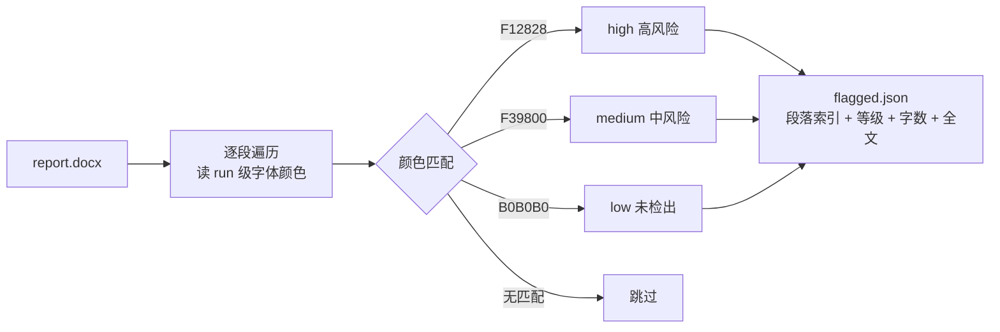
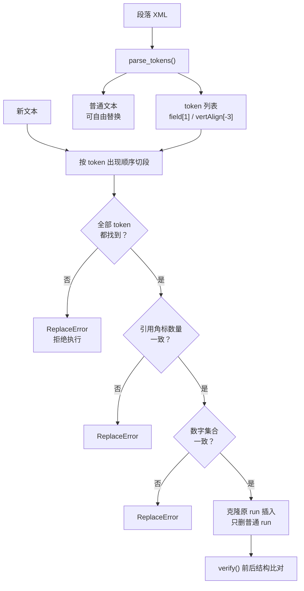

# 案例 02 · 文档批量改写的格式保真

> 工具：`src/docx_domain.py`（核心）+ `src/cli.py`（命令行），依赖仅 `python-docx`
>
> 关键结果：**47 个段落整段重写，0 处格式损坏**；三个负例测试全部被正确拦截。

---

## 1. 问题是怎么来的

一份 3.5 万字的技术文稿需要逐段修订。修订意见来自一份带颜色标注的 Word 报告：红色段落是高风险、橙色中风险、灰色未检出。

这件事表面上很枯燥——读报告、改文字、保存。但它同时踩中了三个坑，每一个都能让"改文字"变成"毁文档"。

真正的问题不是"怎么改文字"，而是：

> **如何在换掉一整段文字的同时，让段落里的非文本结构一个都不少？**

这个问题的答案是通用的。任何做合同修订、多语言本地化、模板批量填充、报告自动生成的人都会撞上同一堵墙。

---

## 2. 坑一：问题清单只存在于字体颜色里

检测报告是 Word，不是 JSON。哪一段有问题、有多严重，唯一的线索是 `w:rPr/w:color/@w:val`。

所以第一步是把它变成结构化数据：



一行命令：

```bash
python cli.py locate report.docx --out flagged.json
# 命中 3 段：{'high': 1, 'medium': 1, 'low': 1}  → flagged.json
```

关键点：**按 run 统计字数而不是按段落判等级**。同一个段落里可能一半红一半黑（只有部分句子被判高风险），按段落整体定级会夸大问题范围。

---

## 3. 坑二：`paragraph.text = "..."` 会静默毁掉文档

这是整个项目的技术核心。

### 3.1 一段文字的真实结构

看起来平铺直叙的一段话，在 OOXML 里是这样的：

```
w:p
├── w:pPr                          首行缩进 24pt / 行距 20pt / 两端对齐
├── w:r   "传统迭代算法的单次重建耗时可达到分钟级"
├── w:r   ┌─ w:fldChar  begin                       ← 域开始
│         ├─ w:instrText " REF _Ref123 \r \h "      ← 域指令：交叉引用
│         ├─ w:fldChar  separate                    ← 分隔：下面开始是结果
│         ├─ w:r/w:t    "[1]"                       ← 域结果（显示的角标）
│         └─ w:fldChar  end                         ← 域结束
├── w:r   "，重建误差约为 10"
├── w:r   rPr/w:vertAlign=superscript  "-3"         ← 上标
└── w:r   " 量级。"
```

用 `python-docx` 最直觉的写法：

```python
paragraph.text = "改写后的整段文字[1]，重建误差约 10-3 量级。"
```

执行结果：段落只剩一个 run，**域没了、上标没了、`pPr` 也不保证还在**。

### 3.2 为什么这个 bug 特别危险

| 破坏 | 什么时候暴露 |
|---|---|
| 引用角标变成死文字 | 交稿前"更新域"或交叉引用重新编号时——角标全部错乱 |
| 上标变普通字符 | 打印预览 / 排版检查时，`10-3` 看起来像减法 |
| 段落属性丢失 | 打开文档就能看出缩进不对（这个反而最好发现） |

前两个都是**静默**的：改完当下看不出任何异常，可能几天后才炸。这类 bug 的修复成本远高于开发成本——因为你要重新定位是哪个环节弄坏的。

---

## 4. 解法：token 槽

思路很简单：**把段落切成"可替换文本"和"必须保留的 token"，改文字，不动 token。**



核心代码（`docx_domain.py`）：

```python
def replace_paragraph(p, new_text, *, strict_numbers=True):
    tokens = parse_tokens(p._element)      # 抽出域 / 上标 / 图片

    # 1) 在新文本里按顺序定位每个 token
    segments, pos = [], 0
    for idx, tok in enumerate(tokens):
        found = new_text.find(tok.text, pos)
        if found < 0:
            raise ReplaceError(f"新文本缺少必须保留的 token {tok.text!r}")
        ...
        segments.append(("token", idx))

    # 2) 三道一致性检查（见下节）

    # 3) 克隆 token 的原始 run，插在普通文本片段之间
    for kind, val in segments:
        els = [_make_run(val, rpr)] if kind == "text" else \
              [copy.deepcopy(r) for r in tokens[val].runs]
        for el in els:
            cursor.addnext(el)
            cursor = el

    # 4) 只删普通 run，pPr 从未被触碰
    for r in plain:
        p_el.remove(r)
```

三个设计决定值得说明：

1. **token 用深拷贝，不是重建**。域的 `instrText`、书签名、`\h` 开关全部原样保留，所以引用在 Word 里仍可正常更新。重建域等于重新发明一个可能不兼容的实现。
2. **`pPr` 完全不参与**。段落属性挂在 `w:p/w:pPr` 上，只要不去动它，缩进行距对齐就永远不会丢。这是"最小改动面"原则。
3. **失败必须抛异常**。所有检查都 `raise ReplaceError` 而不是打日志继续跑——批量处理最怕"部分成功"，那会让你在几百段里找哪一段坏了。

---

## 5. 三道闸门

改文字这件事，最大的风险不是格式，是**把数据改错**。所以我加了三道检查，任何一道不过就拒绝执行：

| 闸门 | 检查什么 | 为什么 |
|---|---|---|
| token 完整性 | 新文本里每个域/上标都能找到 | 防止把 `[1]` 或上标写丢 |
| 角标一致性 | token 之外的文本不得出现 `[n]` | 防止手动多写或少写一个角标，导致引用错位 |
| 数字一致性 | 新旧文本的数字集合必须完全相同 | 防止改写时把 32.47 写成 32.74、把 0.05 秒写成 0.5 秒 |

第三道闸门是我最在意的。文字改得再好，一个数字错了，整篇实验数据的可信度就归零。而且这种错误人工校对极难发现——因为它"看起来正常"。

需要改数字时显式关闭：`--allow-number-change`。

---

## 6. 自检：把"我说它能用"变成"它自己被验证过"

工具自带 `selftest`，不依赖任何外部文件。它构造一份含域、上标、首行缩进的文档，跑完整流程，再落盘读回重新校验：

```
$ python cli.py selftest

原文： 传统迭代算法的单次重建耗时可达到分钟级[1]，重建误差约为 10-3 量级。
  域 1 个 / 上标 1 个 / 数字 ['1', '10', '3'] / pPr=有
替换： ok：2 个 token 保留，5 个片段重建
新文： 传统迭代算法重建一张图像往往要花上分钟级的时间[1]，而重建误差通常停留在 10-3 量级。
结构校验： 通过
落盘重读后校验： 通过
负例·数字变动： 已拦截：新文本缺少必须保留的 token '-3'，拒绝执行
负例·角标丢失： 已拦截：新文本缺少必须保留的 token '[1]'，拒绝执行
负例·数字新增： 已拦截：数字集合发生变化，疑似改写时动到了数据；如确认无误请关闭 strict_numbers

自检结果： 全部通过
```

三个负例是我特意加的。**只测正确路径的测试等于没测**——它只能证明代码能跑，不能证明代码会拦。第三个负例还抓出了一个真问题：前两个负例都是被 token 检查拦下的，如果没有第三个用例，数字校验这条分支实际上是未覆盖的。

---

## 7. 一次方向性错误，比十个 bug 更值钱

这部分和代码无关，但它是这件事里我学到最多的地方。

第一轮改写的思路是"让文字更书面、更规范"：加连接词、补过渡句、把口语表达换成学术表达。

结果检测分不降反升。

原因很反直觉：**越工整、越对称、越像范文，越像 AI 写的**。AI 的文本指纹不在词汇上，在节奏上——每句话长度相近、每个论点都凑成三项并列、每个段落都有"首先/其次/最后"。

第二轮的改法完全相反：

| 第一轮（错） | 第二轮（对） |
|---|---|
| 补"从而""因此""综上所述" | 删掉这些连接词，靠语义衔接 |
| 把句子写长、写完整 | 长短句交错，允许短句独立成句 |
| 论点整理成三项并列 | 打散并列，有的详写有的略写 |
| 保持书面正式 | 允许少量口语化表达（占比约 30%） |

这一轮之后才开始真正下降。

**这条经验的通用版本**：AI 输出的问题往往不在"内容不够好"，而在"太均匀"。均匀是机器最典型的特征——真实的人类写作一定有起伏、有冗余、有偏科。

它也改变了我对"用 AI 干活"的理解：AI 很擅长生成候选，但它天然倾向于产出分布最集中的答案。人的价值在于知道该往哪个方向偏离。

---

## 8. 用法

```bash
pip install python-docx

# 自检（不需要任何输入文件）
python cli.py selftest

# 从检测报告提取问题清单
python cli.py locate report.docx --out flagged.json

# 按改写清单批量替换
python cli.py apply thesis.docx rewrites.json -o thesis.new.docx

# 对比两份文档的结构完整性
python cli.py verify thesis.docx thesis.new.docx
```

`rewrites.json`：

```json
{
  "19": {
    "new": "改写后的整段文字……[1]……",
    "match": "本课题以自然图像为研究对象"
  }
}
```

`match` 字段是**防错位**设计：文档一旦被人手工改过，段落索引就会移位，照着索引硬改会把内容写到错误的段落里。给了 `match` 就先比对原文前缀，不匹配就跳过该条并报告——宁可少改，不可错改。

---

## 9. 已知限制

写出来是为了让别人知道边界在哪：

1. **超链接内的 run 不支持**。`w:hyperlink` 会改变 run 的层级，token 解析只处理段落直接子级。遇到这种情况工具会明确报错而不是猜。
2. **含图片的段落不支持整段重建**。只能走片段替换，因为整段重建需要决定图片在文本中的位置，而这个信息 XML 里没有。
3. **只处理 `w:vertAlign` 判定的上下标**。用字号缩小模拟的"假上标"识别不出来。
4. **`match` 只比前 20 字**。文档大改后仍可能错位，所以批量执行前建议先用 `--out` 输出到新文件，用 `verify` 比一遍再覆盖。
5. **颜色映射是硬编码的**。换一家检测机构的报告就要改 `RISK_COLORS`。

---

<div align="center">

[← 返回作品集主页](../README.md)

</div>
